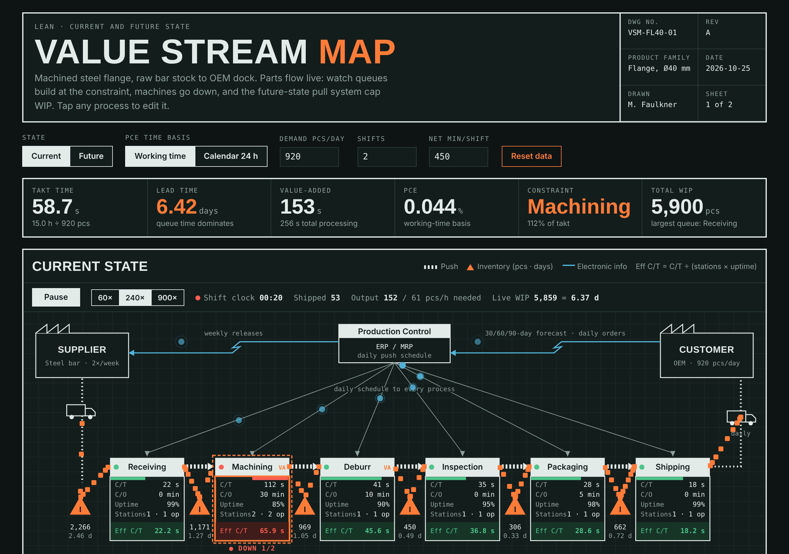
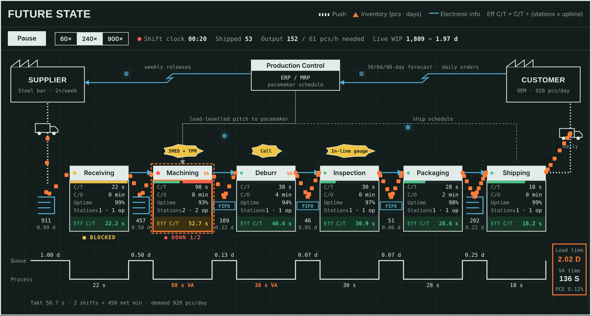

# Value Stream Studio

A live, interactive value stream map (VSM) that runs in the browser. Parts flow through the line in real time, machines break down at rates set by their uptime, queues build at the constraint, and a future-state pull system caps WIP. Every metric recalculates from the data you enter.

Built as a teaching and analysis tool for lean manufacturing. It fixes the common mistakes in "infographic" VSMs: no takt time, cycle times that can't meet demand, and value-added time inflated by counting every step.

[**https://marusfaulkner.github.io/value-stream-map/**](https://marusfaulkner.github.io/value-stream-map/)



## Features

**Live simulation**
- Parts arrive at takt rate, queue at each inventory point, and are pulled into processes as stations free up
- Random breakdowns sized to each process's uptime (shown as **DOWN**)
- Future state uses FIFO lanes and supermarkets with WIP caps; upstream stations show **BLOCKED** instead of overproducing
- Live shift clock, parts shipped, output per hour vs. required rate, and live WIP in days
- Play/pause and 60×, 240× or 900× speed

**Analysis**
- Takt time from demand, shifts and net minutes per shift
- Effective cycle time = C/T ÷ (stations × uptime), flagged OK, tight (>85% of takt) or over takt
- Line balance chart of effective cycle time against takt
- Lead time from inventory days (WIP ÷ daily demand) plus processing time
- Process cycle efficiency (PCE) using only true value-added steps, on a working-time or calendar 24 h basis
- Findings panel generated from the data: constraint, capacity shortfall, queue share of lead time, changeover loss

**Editing**
- Tap any process on the map to edit C/T, changeover, uptime, stations, operators, queue WIP, and whether it is value-added
- Current and future state are kept as separate data sets



## Sample data

The default model is a machined steel flange line: Receiving → Machining → Deburr → Inspection → Packaging → Shipping, 920 pcs/day over two 450-minute shifts (takt 58.7 s).

| | Current state | Future state |
|---|---|---|
| Constraint | Machining at 112% of takt | Machining at 90% of takt |
| Total WIP | 5,900 pcs | 1,850 pcs |
| Lead time | 6.42 days | ~2.0 days |
| Key changes | Daily push schedule to every process | Pacemaker at Machining, SMED + TPM, in-line gauging, FIFO lanes |

Change the numbers in `DEFAULTS` at the top of `js/vsm.js` to model your own value stream.

## Method

| Metric | Formula |
|---|---|
| Takt time | Net available seconds per day ÷ daily demand |
| Effective C/T | C/T ÷ (stations × uptime) |
| Inventory days | Queue WIP ÷ daily demand |
| Lead time | Σ inventory days + Σ C/T |
| PCE | Value-added time ÷ lead time |

Only steps that change the part's form or fit (here, machining and deburr) count as value-added. Receiving, inspection, packaging and shipping are necessary but non-value-added.

## Run it

No build step and no dependencies. Open `index.html` in a browser, or serve the folder:

```bash
python3 -m http.server 8000
# then open http://localhost:8000
```

## Publish with GitHub Pages

1. Push this folder to a new repository.
2. In the repository, go to **Settings → Pages**.
3. Under **Source**, pick **Deploy from a branch**, then `main` and `/ (root)`.
4. The map is live at `https://<your-username>.github.io/<repo-name>/` within a minute or two.

## Project structure

```
vsm-live/
├── index.html        Page markup
├── css/style.css     Theme tokens (light and dark), layout, map styling
├── js/vsm.js         Model, calculations, SVG rendering, live simulation
├── docs/             README screenshots
├── LICENSE
└── README.md
```

## Tech

Plain HTML, CSS and JavaScript. The map and chart are SVG drawn from the data model. The simulation is a discrete-time model stepped inside `requestAnimationFrame`. It follows the system light/dark setting and respects `prefers-reduced-motion` (the simulation starts paused).

## Author

Marcus Faulkner — Quality Inspector with a background in regulated medical device manufacturing (ISO 13485 / 14971).

## License

MIT. See [LICENSE](LICENSE).
